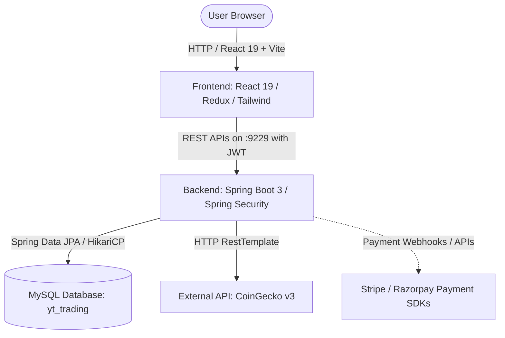

# Functional Specification Document (FSD) — Zosh Trade

## 1. Executive Summary

**Zosh Trade** is a full-stack cryptocurrency trading and portfolio management application. It provides authenticated users with real-time crypto asset tracking, interactive historical price charts, buy/sell order placement, wallet top-up and transfers, watchlist bookmarking, and account security management (including Two-Factor Authentication).

The platform pairs a responsive modern React 19 frontend (driven by Tailwind CSS v4 and Redux) with a Spring Boot 3.x backend, persisting data into a relational MySQL database and sourcing cryptocurrency data from the public CoinGecko API.

---

## 2. System Architecture

- **Frontend Port**: `5173` (Vite dev server)
- **Backend Port**: `9229` (Spring Boot embedded Tomcat)
- **Database Port**: `3306` (MySQL Server)

---

## 3. Core Modules & User Journeys

### 3.1 Authentication & Profile Security
- **User Registration (`POST /auth/signup`)**: Validates unique email address, encrypts passwords, creates user profile and returns an initial JWT authentication token.
- **User Sign-in (`POST /auth/signin`)**: Validates credentials against `CustomUserDetailsService`. If Two-Factor Authentication (2FA) is enabled for the account, sends a 6-digit OTP to the user's email address and returns an intermediate session identifier.
- **Two-Factor Authentication (`POST /auth/two-factor/otp/{otp}`)**: Validates the 6-digit OTP against the active session and completes authentication.
- **Password Reset (`POST /auth/users/reset-password/send-otp` & `POST /auth/users/reset-password/verify-otp`)**: Self-service recovery through email OTP codes.
- **Profile & 2FA Configuration (`GET /api/users/profile`, `PATCH /api/users/enable-two-factor/verify-otp/{otp}`)**: View profile details and toggle 2FA protection.

### 3.2 Crypto Market Data & CoinGecko Integration
- **Paginated Market List (`GET /coins?page={page}`)**: Retrieves paginated coin records formatted with USD pricing, 24-hour price change percentage, total volume, and market capitalization.
- **Top 50 Ranking (`GET /coins/top50`)**: Directly fetches the top 50 cryptocurrencies ranked by market capitalization.
- **Coin Detail (`GET /coins/details/{coinId}`)**: Comprehensive data for a specific coin (symbol, icon, all-time highs/lows, circulating supply, market cap rank).
- **Market Price Chart (`GET /coins/{coinId}/chart?days={days}`)**: Historical price series used by the ApexCharts component across 1-day, 1-week, 1-month, and 1-year time windows.
- **Search & Trending (`GET /coins/search?q={query}`, `GET /coins/trending`)**: Live keyword search across crypto assets and trending coin feeds.

### 3.3 Trading & Order Execution
- **Order Creation & Execution (`POST /api/orders/pay`)**: Supports `BUY` and `SELL` orders.
  - **Buy Order**: Checks wallet balance for sufficient funds. Deducts USD from the user's wallet, creates or updates an `Asset` holding in the user's portfolio, and records an `Order` and `OrderItem`.
  - **Sell Order**: Verifies that the user owns sufficient units of the target asset. Increases the user's wallet USD balance and reduces the asset quantity.
- **Order History (`GET /api/orders`)**: Comprehensive audit trail of historical transactions filterable by order type (`BUY`/`SELL`) and status (`PENDING`/`FILLED`/`CANCELLED`).

### 3.4 Portfolio & Asset Holdings
- **Portfolio Overview (`GET /api/asset`)**: Calculates total portfolio value, individual asset allocations, quantity held, and current market evaluation.
- **Asset Detail (`GET /api/asset/{assetId}`)**: Detailed statistics for individual holdings.

### 3.5 Wallet & Financial Operations
- **Balance & Transaction Auditing (`GET /api/wallet`, `GET /api/transactions`)**: Real-time balance and ledger of deposits, transfers, and order settlements.
- **Deposit / Top-up (`POST /api/wallet/deposit`)**: Integrates with Stripe and Razorpay SDKs to generate payment orders for fiat currency deposit into the platform wallet.
- **User-to-User Transfer (`PUT /api/wallet/{walletId}/transfer`)**: Peer-to-peer balance transfer between verified platform wallets with purpose notes.
- **Withdrawal Requests (`POST /api/withdrawal`, `GET /api/withdrawal`)**: Request fund withdrawal to user's registered bank accounts with status tracking (`PENDING`, `SUCCESS`, `DECLINED`).
- **Admin Withdrawal Management (`GET /api/admin/withdrawal`, `PATCH /api/admin/withdrawal/{id}/proceed/{accept}`)**: Admin approval pipeline for fund withdrawals.

### 3.6 Watchlist (Bookmarking)
- **User Watchlist (`GET /api/watchlist/user`)**: Personal list of saved cryptocurrencies.
- **Toggle Coin (`PATCH /api/watchlist/add/{coinId}`)**: Instant bookmark toggle available on both the Coin Details view and the Home table.

### 3.7 Interactive Assistant (Chatbot Widget)
- Floating assistant modal on the frontend homepage providing user interaction and navigation support.

---

## 4. Entity Relationship Model

| Entity | Primary Attributes | Relationships |
| :--- | :--- | :--- |
| `User` | `id`, `fullName`, `email`, `password`, `role` | 1:1 `Wallet`, 1:1 `TwoFactorAuth`, 1:1 `Watchlist`, 1:M `Order` |
| `Wallet` | `id`, `balance` | Belongs to `User`, 1:M `WalletTransaction` |
| `WalletTransaction`| `id`, `type`, `date`, `transferId`, `purpose`, `amount` | Belongs to `Wallet` |
| `Coin` | `id`, `name`, `symbol`, `currentPrice`, `marketCap`, `totalVolume` | Standalone market data entity |
| `Asset` | `id`, `quantity`, `buyPrice` | Belongs to `User`, references `Coin` |
| `Order` | `id`, `orderType`, `price`, `timestamp`, `status` | Belongs to `User`, 1:1 `OrderItem` |
| `OrderItem` | `id`, `quantity`, `buyPrice`, `sellPrice` | Belongs to `Order`, references `Coin` |
| `Watchlist` | `id` | Belongs to `User`, M:M `Coin` |
| `Withdrawal` | `id`, `amount`, `status`, `date` | Belongs to `User` |
| `PaymentDetails` | `id`, `accountNumber`, `accountHolderName`, `ifsc`, `bankName` | Belongs to `User` |

---

## 5. Security & Operational Specifications

1. **Stateless Security**: Spring Security uses `SessionCreationPolicy.STATELESS`. Every authenticated request requires the `Authorization: Bearer <JWT>` header.
2. **CORS Whitelist**: Whitelists frontend dev server origins (`http://localhost:5173`) with allowed methods (`GET`, `POST`, `PUT`, `DELETE`, `OPTIONS`) and credentials enabled.
3. **Public Endpoints**: `/auth/**`, `/coins/**`, `/home` are publicly accessible.
4. **Protected Endpoints**: `/api/**` requires valid JWT token authentication.
5. **Admin Endpoints**: `/api/admin/**` requires `ROLE_ADMIN` authority.
